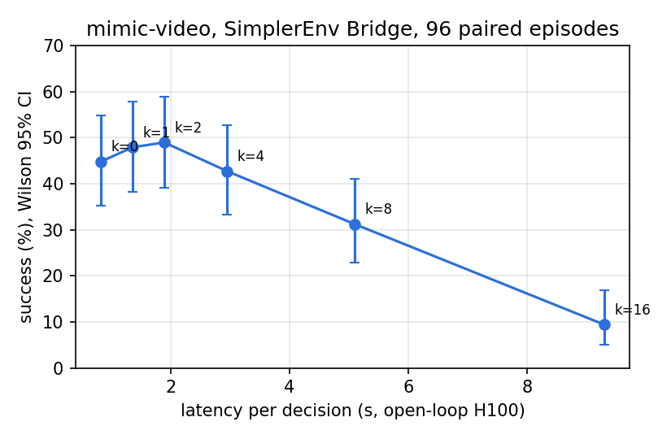

# Experiment 9 — How deep does mimic-video's forecast go, and does the decoder follow it? (open loop 2026-11-12, closed loop 2026-11-15)

Advisor point 4 (vary the number of generation steps; success vs. total
latency), mimic-video part. Motivation: at the deployed operating point
(`stop=1`) foresight and perception share the same context tokens and cannot
be ablated separately (`../experiment1_ablation/README.md`, "Can the future
be removed while keeping perception?"). This experiment varies the step `k`
after which the decoder reads the video model's layer-20 activations, as in
the mimic-video paper's own analysis of the video flow time τv, and adds a
test that leaves perception untouched: the video model's random seed.

Key fact from the training code (`model/cosmos_predict2/models/world2action_model.py`,
`get_crossattn_emb`): the decoder was trained on activations of the **real**
future video (56 frames at 5 Hz) noised to a random sigma. At small sigma it
expects the real future in the future tokens; at inference it gets the
video model's own prediction.

## Setup

`depth_open_loop.py` (job 755694, H100, 38 min; log `depth-ol-755694.out`,
per-clip data `depth_open_loop_8ep.json`). 16 real Bridge clips (8 episodes ×
2 time points, own task string): 5 observed frames + the 56 real future frames
as in training (past the episode end the last frame repeats). Fixed robot
state, decoder seed 0. `k` ∈ {0, 1, 2, 4, 8, 16, 23, 30} of 35 steps.

- **Self-check:** the test re-implements the sampling loop to read several
  steps per run; at `k=1` its action equals the production call exactly
  (max |diff| = 0).
- **Forecast quality:** the video model's clean-video estimate at step `k`
  (latent space), error to the real future, divided by the error of a
  "nothing moves" future (last observed frame repeated). < 1: closer to the
  truth than a static scene.
- **Seed test:** video seeds 0–3. Same frames, same instruction, so
  perception is identical; only the imagined future differs. *Follow
  future*: seed 0's context with the future tokens (latent frames 2–15) of
  seed s; 0 = the action stays with seed 0, 1 = it moves to seed s's action.
  *Follow observed* (control): the same with the observed tokens swapped.
- **Oracle:** the context built as in training from the real future noised to
  the same sigma; action change vs. the model's own forecast.
- Actions are compared between conditions only, never to the dataset's
  actions.

## Results (mean over 16 clips)

| k | sigma | forecast error vs. static | future spread across seeds | action spread across seeds | follow future | follow observed (control) | oracle vs. own forecast | translation | rotation error | latency (s) |
|---|---|---|---|---|---|---|---|---|---|---|
| 0 | 80.0 | 0.69 | 0.09 | 3% | 0.77 | 0.23 | 14% | 0.070 | 0.007 | 0.82 |
| **1 (deployed)** | 68.3 | 0.69 | 0.11 | 4% | 0.79 | 0.22 | 16% | 0.069 | 0.007 | 1.36 |
| 2 | 58.1 | 0.70 | 0.15 | 6% | 0.82 | 0.20 | 16% | 0.068 | 0.007 | 1.89 |
| 4 | 41.6 | 0.74 | 0.31 | 14% | 0.87 | 0.13 | 21% | 0.068 | 0.008 | 2.95 |
| 8 | 20.2 | 0.86 | 0.50 | 19% | 0.85 | 0.17 | 27% | 0.066 | 0.008 | 5.09 |
| 16 | 3.65 | 0.95 | 0.59 | 32% | 0.84 | 0.18 | 31% | 0.068 | 0.011 | 9.30 |
| 23 | 0.52 | 0.97 | 0.61 | 32% | 0.80 | 0.21 | 31% | 0.068 | 0.010 | 13.03 |
| 30 | 0.04 | 0.99 | 0.63 | 21% | 0.76 | 0.26 | 19% | 0.049 | 0.023 | 16.71 |

No NaN. "Follow future" exceeds "follow observed" in 16/16 clips at every `k`
checked (1, 4, 16, 23). Latency: production call without CUDA graphs, one
clip, H100 NVL (Experiment 3 measured 1.06 s at `k=1` in the real eval loop).

## What this means

1. **The decoder follows the imagined future.** With perception held fixed,
   swapping in another seed's future tokens moves the action ~80% of the way
   to that seed's action; swapping the observed tokens moves it ~20%. This
   holds at every depth. So the decoder does read the future part of its
   context, not only a view of the present.
2. **With depth, the imagined future becomes specific and the action depends
   on it.** Different seeds' futures differ by 9% at `k=0` and ~60% from
   `k=16` on; the action differs by 3–4% at `k≤1` and ~32% at `k=16–23`.
   At the deployed `k=1` the future is still close to a seed-independent
   average, so the action barely depends on the seed.
3. **Deeper forecasts are not closer to the truth.** The error to the real
   future grows from 0.69 to 0.99 of a static scene's error. Caveat: a
   squared-error metric favours a blurry average over a sharp guess, so this
   says the specific futures are not *on average* closer to the truth, not
   that they are useless. Also, Bridge episodes are short: the clips have
   7–41 real future frames (of 56), the rest repeats the episode's last frame
   (the same clamping as in training). That part of the "real future" *is*
   static, which favours the static baseline; the near-future ratio (first 3
   future latent frames, where 15/16 clips still have real frames) shows the
   same trend (0.63 → 0.94).
4. **Given the real future, the decoder acts differently** (14–31% change),
   about as much as between two seeds at the same depth: to the decoder the
   real future looks like one more plausible future.
5. **Cost:** latency grows ~0.5 s per step, from 1.4 s at `k=1` to 13 s at
   `k=23`. At `k=30` the decoder starts leaving its normal range (rotation
   error ×3, less motion).

**Hypothesis for the closed loop:** the earlier unpaired result (success
47.9% at `k=1`, 11.5% at `k=23`) fits a decoder that follows its forecast:
deeper forecasts commit to one specific future, the action follows it, and
when that future is wrong the episode fails. Tested below.

## Closed loop (2026-11-15)

**Setup.** `closed_loop.slurm` (jobs in `jobs.txt`, 20 jobs, all
`EVAL_EXIT=0`): the deployed baseline policy with only
`--vam-stop-video-denoising-step` changed, `k` ∈ {0, 2, 4, 8, 16}, the same
4 tasks × 24 episodes as Experiment 1, decoder seed 0. The `k=1` row is
Experiment 1's `stop=1` baseline rerun (`exp1_baseline_stop1_seed0`, same
script and episodes). SimplerEnv places objects deterministically per
episode index, so every condition is paired with `k=1` episode by episode.
Statistics: `analyze_closed_loop.py` → `../paired_stats.py` (Wilson CIs,
stratified paired bootstrap, exact McNemar); per-condition numbers in
`closed_loop_summary.json`, plot `closed_loop_success_vs_latency.png`.

Latency is the open-loop per-decision time from the table above (H100 NVL);
the closed-loop logs do not time individual calls. SimplerEnv is
synchronous (`maniskill2_evaluator.py` calls `model.step` and only then
`env.step`), so the world waits while the model thinks: latency itself
cannot fail an episode here, and any change in success comes from what the
decoder receives, not from delay.

| k | latency (s) | success | Wilson 95% | paired diff vs `k=1` [95% CI] | exact McNemar p | moved correct object | grasped |
|---|---|---|---|---|---|---|---|
| 0 | 0.82 | 43/96 = 44.8% | [35.2, 54.7] | −3.1 pp [−10.4, +3.1] | 0.55 | 63/96 | 63/96 |
| **1 (deployed)** | 1.36 | 46/96 = 47.9% | [38.2, 57.8] | — | — | 64/96 | 61/96 |
| 2 | 1.89 | 47/96 = 49.0% | [39.2, 58.8] | +1.0 pp [−4.2, +6.2] | 1.00 | 65/96 | 66/96 |
| 4 | 2.95 | 41/96 = 42.7% | [33.3, 52.7] | −5.2 pp [−12.5, +2.1] | 0.27 | 59/96 | 60/96 |
| 8 | 5.09 | 30/96 = 31.2% | [22.9, 41.1] | **−16.7 pp [−26.0, −7.3]** | 0.014 | 44/96 | 49/96 |
| 16 | 9.30 | 9/96 = 9.4% | [5.0, 16.9] | **−38.5 pp [−47.9, −29.2]** | <0.0001 | 35/96 | 28/96 |

Per task (successes of 24):

| k | Carrot | Eggplant | Spoon | Stack cubes |
|---|---|---|---|---|
| 0 | 9 | 23 | 8 | 3 |
| 1 | 9 | 21 | 12 | 4 |
| 2 | 9 | 23 | 11 | 4 |
| 4 | 9 | 16 | 12 | 4 |
| 8 | 13 | 3 | 8 | 6 |
| 16 | 3 | 1 | 3 | 2 |

### What this means

1. **Shallow is as good as deployed, deeper is worse.** `k=0`–`4` are
   statistically indistinguishable from `k=1` (every paired CI contains 0).
   From `k=8` success falls, and at `k=16` it is down to 9.4% (40 episodes
   lost, 3 gained). The unpaired 11.5% at `k=23` fits this curve. So the
   operating point mimic-video ships with (`k=1`, the cheapest setting short
   of `k=0`) is also the best one measured: more generation costs time and
   loses success, a monotone trade-off past `k=2`.
2. **The failures start early in the episode.** At `k=16` the robot moves
   the correct object in 35/96 episodes (vs. 64/96) and grasps it in 28/96
   (vs. 61/96): deep forecasts already hurt reaching and grasping, not only
   the final placement.
3. **This matches the open-loop picture.** The range where success holds
   (`k≤4`) is where the imagined futures barely depend on the seed (spread
   ≤0.31) and the action barely depends on the future (≤14%); the collapse
   comes where the future becomes specific (spread 0.5–0.6) and the action
   follows it (19–32%), while the forecast is no closer to the truth.
4. **Not separated yet: which of two causes.** (a) The decoder follows one
   specific but wrong future (the hypothesis above). (b) Train/test
   mismatch: at small sigma the decoder was trained on the *real* future
   noised to that sigma, so at deep `k` it gets a clean-looking future that
   is not the real one — exactly the input it never saw. Both predict the
   same closed-loop curve. A test that separates them: at `k=16`, average
   the action over several video seeds — this removes the commitment to one
   future (helps under (a)) but not the mismatch (no help under (b)).
5. **Task dependence.** The `k=8` drop is mostly Eggplant (21 → 3; the only
   task with the sink camera and 120 steps), while Carrot even rises
   (9 → 13, single task, not tested on its own). With 24 episodes per task
   these per-task differences are suggestive only.

**Limits.** One decoder seed; 96 episodes; latency measured open loop on
H100 (the jobs ran mostly on H200). Because the simulator waits for the
model, the real-robot cost of deep `k` would be larger than shown here: a
physical scene keeps moving during a 9 s decision.
